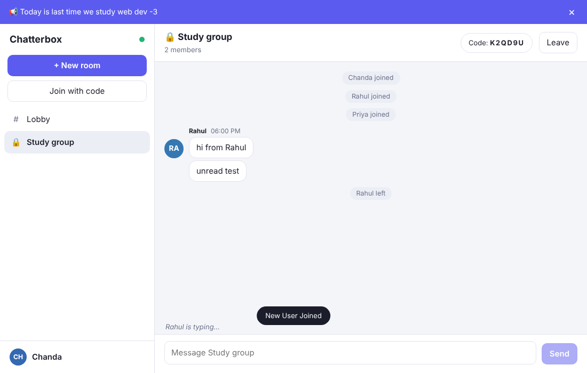

# 💬 Chatterbox – Real-Time Chat App

A real-time chat application built with **Node.js, Express, Socket.IO and React**.
I built the frontend for the chat backend we studied in class, and added my own feature:
**personal rooms** that any number of friends can join using a code.

**Name:** Sumit  

| Desktop | Mobile |
|---|---|
|  |  |

---

## ✨ Features

- Pick a display name and start chatting instantly
- **Public Lobby** that everyone joins
- **Personal rooms** – create a room, get a 6-character code, share it, and anyone can join
- Join / leave notices and a live member list
- "Someone is typing…" indicator
- Unread message badges on rooms
- Auto-reconnect – rejoins your rooms if the connection drops
- Works on mobile, with automatic light / dark mode

## 🛠️ Tech Stack

| Part | Technology |
|---|---|
| Backend | Node.js, Express 5, Socket.IO 4 |
| Frontend | React 18, Vite, plain CSS |
| Realtime | WebSockets via `socket.io-client` |

## 🚀 Getting Started

**You need:** [Node.js](https://nodejs.org) 18 or newer.

```bash
# 1. Open a terminal inside the chatapp folder

# 2. Install backend packages
npm install

# 3. Build the React frontend
npm run build

# 4. Start the server
npm start
```

Now open **http://localhost:8080** in two or three browser tabs, use different names, and chat!

### Working on the frontend (hot reload)

```bash
npm start                    # terminal 1 → backend on port 8080
cd client && npm run dev     # terminal 2 → frontend on http://localhost:5173
```

## 📁 Project Structure
chatapp/
├── server.js            # original class backend (+1 line to load my features)
├── chatFeatures.js      # my additions: messages, rooms, typing, members
├── client.html          # original class test client
├── package.json
└── client/              # React frontend (Vite)
    └── src/
        ├── App.jsx          # socket connection + actions
        ├── reducer.js       # all chat state in one place
        ├── socket.js        # socket.io client helper
        ├── styles.css
        └── components/      # Login, Sidebar, ChatPane, RoomModal, Avatar

## 🔌 How It Works

I did **not** rewrite the existing backend. `server.js` is unchanged except for one line that loads
`chatFeatures.js`, where all the new events live.

**Events from the original backend (still working):**

| Event | Shown in the UI as |
|---|---|
| `gyankibaat` | Welcome toast |
| `join` | "New User Joined" toast |
| `announcement` | Banner at the top |

**Events I added:**

| Event | Direction | Purpose |
|---|---|---|
| `user:set` | client → server | Set name and enter the Lobby |
| `room:create` | client → server | Create a personal room and get its code |
| `room:join` | client → server | Join a room using a code |
| `room:leave` | client → server | Leave a personal room |
| `message:send` | client → server | Send a message to a room |
| `typing` | both | Typing indicator |
| `message:new` | server → client | New message in a room |
| `room:members` | server → client | Updated member list |

## 🧠 What I Learned

- How Socket.IO keeps a two-way connection open with `emit` and `on`
- How rooms work: `socket.join(id)` and `io.to(id).emit(...)` send messages only to one room
- Using acknowledgement callbacks so the client knows if an action worked
- Managing complex state in React with `useReducer`
- Adding features to existing code without breaking it

## 🔮 Future Improvements

- Save messages in a database (MongoDB) so they survive a server restart
- User accounts and login
- Password-protected rooms
- Image and emoji sharing
- Private one-to-one messages

